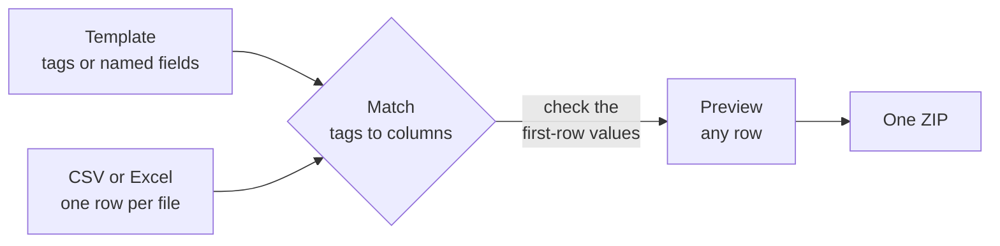
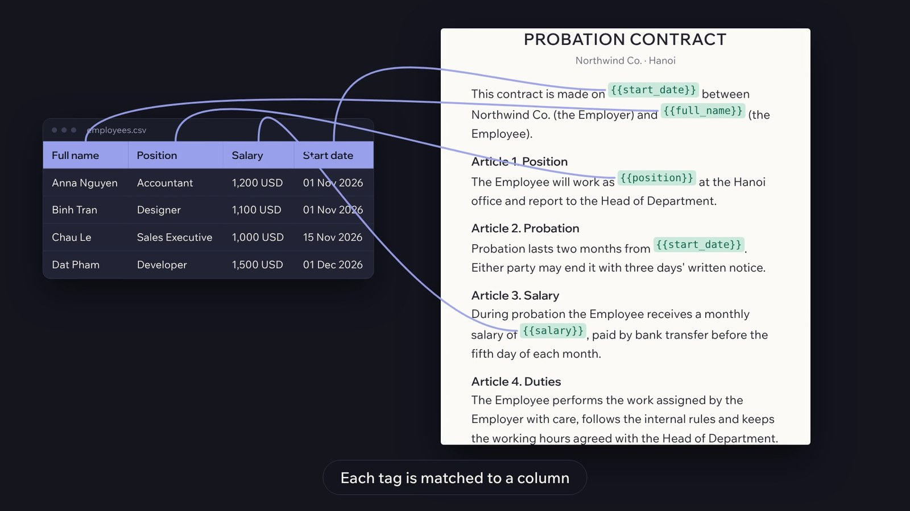

<div align="center">


# Sheetstamp

**Fill Word and image templates from Excel or CSV. Export hundreds of files in one ZIP.**

Offline desktop app for Windows and Ubuntu. No upload, no account, no telemetry.

[](https://github.com/nhhthong/sheetstamp/releases/latest)
[](https://github.com/nhhthong/sheetstamp/actions/workflows/ci.yml)
[](LICENSE)

[Download](https://github.com/nhhthong/sheetstamp/releases/latest) ·
[Website](https://nhhthong.github.io/sheetstamp/) ·
[Demo video](https://github.com/nhhthong/sheetstamp/blob/main/site/assets/how.mp4) ·
[Tiếng Việt](https://nhhthong.github.io/sheetstamp/vi/) ·
[Specification](docs/specification.md)

</div>

## Quick start

1. [Download](https://github.com/nhhthong/sheetstamp/releases/latest) and install Sheetstamp.
2. In a Word file, write a tag where each value goes: `Employee: {{full_name}}`. Keep your data in a CSV or Excel file, one row per document.
3. In the app, pick the data and the template, check the matched columns, export. The result is one ZIP.

## Features

- **Word templates:** `{{tags}}` in a normal `.docx`, in text, tables, headers and footers. A tag name can be any text.
- **Image templates:** named text boxes on a PNG or JPEG, any installed font, export PNG or JPG.
- **Spreadsheets:** `.csv` and `.xlsx`, Vietnamese encodings, leading zeros kept.
- **Column matching:** Word tags match columns by name (accents and small typos ignored); image fields take the columns in order. Each field shows its first-row value, and a column fills one field.
- **Safe output:** a file-name pattern, duplicates and invalid names handled, one bad row never stops the batch.
- **Private:** works offline, no network calls, light and dark themes, English or Vietnamese.



<p align="center">
  
</p>

## Install

| Platform | File |
|---|---|
| Windows 10/11 (x64) | `Sheetstamp-Setup-x64.exe` |
| Ubuntu 22.04 / 24.04 (x64) | `Sheetstamp-x64.deb` (`sudo apt install ./Sheetstamp-x64.deb`) or `Sheetstamp-x64.AppImage` |
| macOS | Coming soon |

The Windows installer is not code-signed yet, so SmartScreen may warn: choose **More info**, then **Run anyway**.
Check a download against `SHA256SUMS.txt` from the same release:

```bash
sha256sum -c SHA256SUMS.txt --ignore-missing         # Linux
certutil -hashfile Sheetstamp-Setup-x64.exe SHA256   # Windows, compare with the matching line
```

## Develop

Needs Node.js 22.12 or newer.

```bash
npm ci
npm run dev         # app with hot reload
npm run lint        # Biome
npm run typecheck   # TypeScript
npm test            # Vitest
npm run test:e2e    # Playwright, needs a display (on Linux: xvfb-run -a)
```

Code is in `src/main`, `src/preload`, `src/renderer`, `src/shared` and `src/worker`. The website in `site/` is generated: edit `scripts/site/`, run `npm run build:site`.
More: [specification](docs/specification.md), [glossary](GLOSSARY.md), [decisions](docs/adr).

## Contributing

Open an issue first for anything beyond a small fix. One branch and one pull request per ticket, Conventional Commits, and `npm run lint`, `npm run typecheck` and `npm test` passing.

## License

[MIT](LICENSE). Third-party licenses: [THIRD-PARTY-NOTICES.md](THIRD-PARTY-NOTICES.md).
