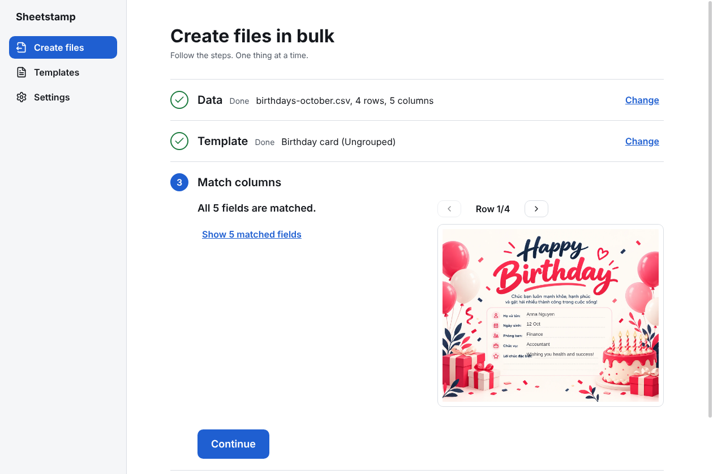
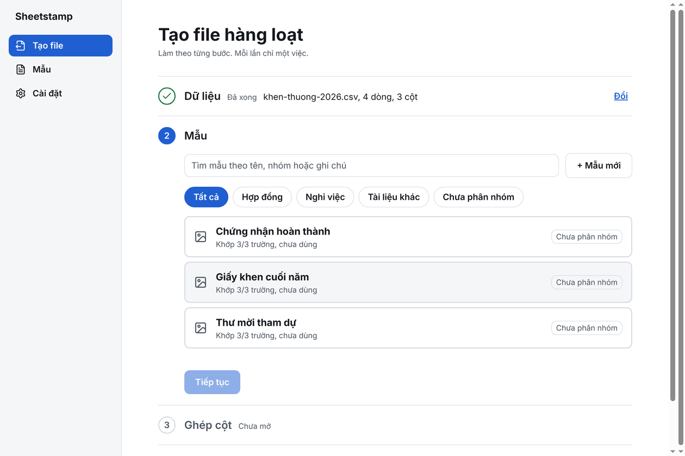
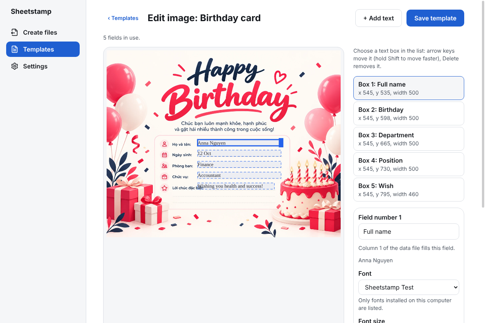

<div align="center">


# Sheetstamp

**Fill Word and image templates from Excel or CSV. Export hundreds of files in one ZIP.**

Offline desktop app for Windows and Ubuntu. No upload, no account, no telemetry.

[](https://github.com/nhhthong/sheetstamp/actions/workflows/ci.yml)
[](LICENSE)


[Website](https://nhhthong.github.io/sheetstamp/) ·
[Download](https://github.com/nhhthong/sheetstamp/releases/latest) ·
[Tiếng Việt](https://nhhthong.github.io/sheetstamp/vi/) ·
[Specification](docs/specification.md)

</div>

<p align="center">
  
</p>

## Why Sheetstamp

HR, accounting and administrative teams produce the same document for hundreds of people: contracts, payroll
slips, transfer letters, certificates. Copying values by hand is slow and error-prone, and uploading employee data to
a web service is often not allowed.

Sheetstamp does it on your own computer. Pick a template, pick a spreadsheet, check a preview, export.

## Features

| | |
|---|---|
| **Word templates** | Put `{{name}}` tags in a normal `.docx`, including tables, headers and footers. Templates live in a local library. |
| **Image templates** | Place text boxes on a PNG or JPEG background in a built-in editor. Any installed font; shrink, wrap, truncate or error when text is too long. Export PNG or JPG. |
| **Spreadsheets** | Reads `.csv` and `.xlsx` (several sheets). Detects Vietnamese encodings (UTF-8, Windows-1258) and keeps leading zeros in IDs and phone numbers. |
| **Automatic matching** | Matches columns to tags by name, ignoring diacritics and small typos. A preview shows the first rows filled in. |
| **Safe file names** | Names files from a pattern such as `{{name}}`, avoids duplicates and characters Windows rejects. |
| **One ZIP** | Progress and a Cancel button. One bad row never stops the batch; a CSV report lists the rows that failed. |
| **Private by design** | Works offline. No automatic updates, no network calls, no account. |
| **Themes and language** | Light, dark or system theme. English (default) or Vietnamese interface, chosen in Settings. |

## How it works

<table>
  <tr>
    <td width="33%"></td>
    <td width="33%"></td>
    <td width="33%"></td>
  </tr>
  <tr>
    <td align="center"><b>1. Data and template</b></td>
    <td align="center"><b>2. Match columns</b></td>
    <td align="center"><b>3. Image editor</b></td>
  </tr>
</table>

Then choose the file-name pattern and export. The result is one ZIP.

## Install

Download from the [latest release](https://github.com/nhhthong/sheetstamp/releases/latest).

| Platform | File |
|---|---|
| Windows 10/11 (x64) | `Sheetstamp-Setup-x64.exe` |
| Ubuntu 22.04 / 24.04 (x64) | `Sheetstamp-x64.deb` or `Sheetstamp-x64.AppImage` |
| macOS | Coming soon. Builds exist for testing only. |

Each release also publishes `SHA256SUMS.txt`:

```bash
sha256sum -c SHA256SUMS.txt --ignore-missing   # Linux
certutil -hashfile Sheetstamp-Setup-x64.exe SHA256   # Windows
```

The Windows installer is not code-signed yet, so Windows SmartScreen may warn when you run it.

```bash
sudo apt install ./Sheetstamp-x64.deb   # Ubuntu
```

## Privacy

- Files are read and written only on your computer.
- The app makes no network calls and sends no telemetry.
- Source code is open under the MIT license, so this can be checked.

## Develop

Requires Node.js 22.12 or newer (CI uses 24).

```bash
npm ci
npm run dev        # start the app with hot reload
npm run lint       # Biome
npm run typecheck  # TypeScript
npm test           # Vitest
npm run build      # the shipped build; contains no test-only pages
npm run test:e2e   # builds with `npm run build:e2e` first, then runs Playwright (needs a display)
```

Electron needs a display. On Linux without one, run `xvfb-run -a npm run test:e2e`. Where `NODE_OPTIONS` is set (some
containers set `--use-openssl-ca`, which Electron rejects), clear it for that command:
`env -u NODE_OPTIONS xvfb-run -a npm run test:e2e`.

`npm run build:e2e` is `electron-vite build --mode e2e`: it adds the test-only page `out/renderer/preview/demo.html`
(used by `tests/e2e/preview.spec.ts`). To run one spec by hand, run `npm run build:e2e` first, then
`npx playwright test tests/e2e/<spec>`. The plain `npm run build` never produces that page.

The website in `site/` is generated: edit `scripts/site/` and run `npm run build:site`.

### Project layout

| Path | Contents |
|---|---|
| `src/main` | Electron main process and the file work |
| `src/preload` | Preload bridge |
| `src/renderer` | React UI (English and Vietnamese) |
| `src/shared` | Types and IPC contracts |
| `src/worker` | Heavy work off the main thread |
| `docs/` | [Specification](docs/specification.md), decisions in `docs/adr/` |
| `GLOSSARY.md` | Project terms |

Built with Electron, React, TypeScript, Vite, Tailwind CSS, Konva, `easy-template-x` and ExcelJS.

## License

[MIT](LICENSE). Third-party licenses: [THIRD-PARTY-NOTICES.md](THIRD-PARTY-NOTICES.md).
